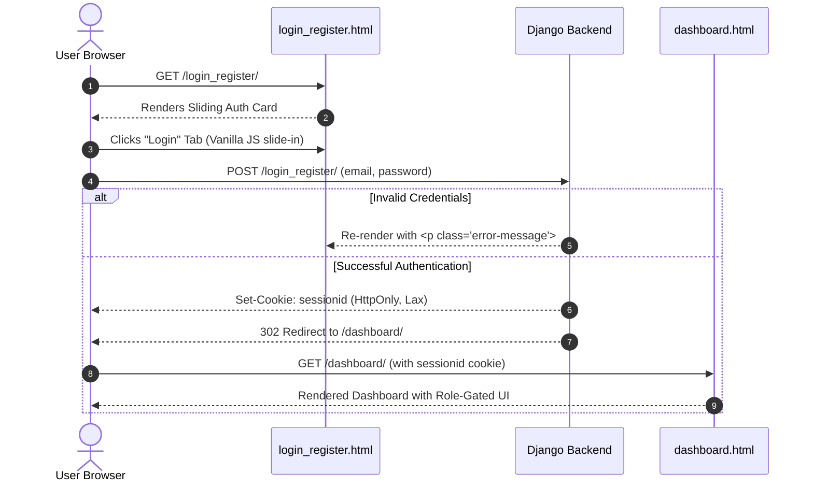

# Frontend Technical Audit & Architecture Analysis: MITR

---

## 1. Project Overview

- **Summary**: MITR's frontend is a server-rendered operations portal designed for IT hardware and field service organizations to assign, monitor, and verify service tasks, track employee productivity, and manage third-party customer subscriptions.
- **Application Type**: Multi-Page B2B SaaS Operations & Task Management Dashboard (Server-Side Rendered MPA).
- **Intended User**: Operations managers, coordinators, and field service technicians (primarily internal personnel at Nescube Technology Pvt. Ltd. / Nestech India).

---

## 2. Tech Stack

| Layer / Category | Technology / Library | Implementation Details |
| :--- | :--- | :--- |
| **Architecture / Paradigm** | Multi-Page Application (MPA) | Server-Side Rendered (SSR) via Django Template Language (DTL) |
| **Framework** | **None** | No SPA framework (No React, Next.js, Vue, or Angular) |
| **Styling Solution** | Tailwind CSS v2.2.19 (CDN) + Custom Vanilla CSS | CDN stylesheet: `jsdelivr.net/npm/tailwindcss@2.2.19` combined with large inline `<style>` tags per template |
| **Typography & Icons** | FontAwesome 5.15.3 + Google Sans | FontAwesome via cdnjs; Google Sans via Google Fonts |
| **State Management** | Server-Hydrated Context + Local Vanilla JS | Session-based state from Django context; ephemeral DOM state via Vanilla JavaScript |
| **Routing** | Django URL Dispatcher | Traditional browser page transitions (`<a href="...">` and form POST redirects); no client-side router |
| **HTTP Client** | Native HTML Forms + Browser `fetch()` API | Standard form POSTs for 95% of interactions; single `fetch()` AJAX call for coordinator status toggle |
| **UI Component Library** | **None** | Handcrafted HTML/CSS markup with Tailwind utilities and custom CSS (no ShadCN, MUI, Chakra) |
| **Build Tool / Bundler** | **None** | No build pipeline (no Vite, Webpack, Turbopack, npm, or PostCSS); assets served raw or via WhiteNoise |
| **Visualization / Charts** | Server-side Matplotlib (PNG delivery) | Delivered as static image tags (``); no client-side Chart.js or D3 |

---

## 3. Project Structure

```text
mitr/
├── static/                              # Static asset directory (served via WhiteNoise)
│   ├── cloudy_mountains.jpg             # High-resolution login page background (866 KB)
│   ├── favicon.ico                      # Uncompressed favicon (205 KB)
│   ├── mitr_logo.jpg                    # Application brand logo
│   └── images/                          # Statically persisted employee progress bar charts (.png)
└── MITR_app/
    └── templates/                       # Server-rendered Django HTML templates
        ├── login_register.html          # Authentication portal (sliding tab card)
        ├── dashboard.html               # Primary operations dashboard with task & employee modals
        ├── employee_list.html           # Team directory with live search & AJAX switch
        ├── employee_progress.html       # Individual employee workload cards & embedded chart
        ├── summary_report.html          # Audit report table with date/status filters & Excel export
        ├── subscriptions.html           # Third-party client subscription tracker & creation modal
        ├── task_view.html               # Task inspection, overdue reason input, and approval actions
        ├── add_employee.html            # Standalone employee creation page (redundant to modal)
        ├── confirm_remove_employee.html # Deletion confirmation dialog
        └── add_task.html                # Orphaned/unused template file
```

### Key Structural Characteristics
- **No Shared Base Layout**: The templates do not use Django's `` or `` partials. The sidebar markup, navigation buttons, and CSS definitions are duplicated across templates.
- **Entry Point**: `MITR_app/templates/login_register.html` rendered at route `/` or `/login_register/`.

---

## 4. Pages & Routing

| Route Path | Template Name | Rendered Views & Capabilities | Protected / Auth Required |
| :--- | :--- | :--- | :--- |
| `/` or `/login_register/` | `login_register.html` | Centered glassmorphic card with sliding Login and Register tabs; displays validation flash messages. | **Public** (Unauthenticated) |
| `/dashboard/` | `dashboard.html` | Fixed collapsible sidebar, role indicator, search bar, paginated task list with verification badges, "Add Task" modal, "Add Employee" modal. | **Yes** (`@login_required`) |
| `/employee_list/` | `employee_list.html` | Employee contact directory, live client-side search, AJAX-driven Coordinator permission toggle, delete confirmation modal. | **Yes** (Coordinator / Superuser) |
| `/employee/<int:id>/progress/` | `employee_progress.html` | Contact summary, metric cards (Total, Completed, Pending, Overdue), embedded Matplotlib progress graph, and task history. | **Yes** (Coordinator / Superuser) |
| `/summary_report/` | `summary_report.html` | Date picker, cadence selector (Daily/Weekly/Monthly), status filter, tabular task breakdown, and Excel download button. | **Yes** (Coordinator / Superuser) |
| `/subscriptions/` | `subscriptions.html` | Paginated customer subscription table (Netflix, Prime, Hotstar), expiry status pills, and "Add Subscription" modal popup. | **Yes** (Coordinator / Superuser) |
| `/dashboard/task/<int:id>/` | `task_view.html` | Task detail cards, client information, approval trail, overdue reason textarea, and verification/rework buttons. | **Yes** (`@login_required`) |
| `/add_employee/` | `add_employee.html` | Basic standalone form for employee registration (duplicate of dashboard popup). | **Yes** (Auth required, broken redirect) |
| `/confirm-remove-employee/<int:id>/` | `confirm_remove_employee.html` | Minimal deletion confirmation screen with Back navigation. | **Partial** (Missing RBAC check) |
| *(None)* | `add_task.html` | Standalone task creation form. | **Orphaned** (Not referenced by any URL) |

---

## 5. Component Architecture

Because this is a server-rendered application without a component framework (React/Vue/Svelte), components exist as recurring HTML/CSS UI patterns rather than modular code units:

### 1. Collapsible Sidebar Navigation (`.sidebar`)
- **Found in**: `dashboard.html`, `employee_list.html`, `summary_report.html`, `subscriptions.html`.
- **Structure**: Fixed sidebar containing action buttons (`.sidebar-btn`), FontAwesome icons, and collapsible text spans.
- **State**: Toggled via Vanilla JS adding/removing `.collapsed` to `.sidebar` and `.expanded` to `.main-content`.
- **Anti-Pattern**: Invalid HTML nesting: anchor tags wrapping buttons (`<a href="..."><button class="sidebar-btn">...</button></a>`).

### 2. Modal Dialog Overlays (`.popup` / `.modal`)
- **Found in**: `dashboard.html` (`#popup`, `#addEmployeePopup`), `employee_list.html` (`#confirmModal`), `subscriptions.html` (`#addSubscriptionPopup`).
- **Structure**: Fixed overlay (`position: fixed; inset: 0; background: rgba(0,0,0,0.5); backdrop-filter: blur(5px)`).
- **State**: Toggled imperatively via JavaScript (`element.style.display = 'block'` / `'none'` or Tailwind `.hidden` / `.flex`).

### 3. Status Badges & Multi-State Verification Matrix
- **Found in**: `dashboard.html` and `summary_report.html`.
- **Structure**: Pill-shaped status indicators with conditional colors:
  - `status-completed`: Green background (`#d1fae5`, text `#065f46`)
  - `status-pending`: Yellow background (`#fef3c7`, text `#92400e`)
  - `status-overdue`: Red background (`#fee2e2`, text `#991b1b`)
  - `status-completed-overdue`: Indigo background (`#e0e7ff`)
- **Verification Column**: Renders composite visual icons combining FontAwesome checks/crosses and user verification symbols to differentiate between technician completion and coordinator approval.

### 4. Sliding Card Panel
- **Found in**: `login_register.html`.
- **Structure**: Container with absolute positioned forms (`right: -100%`) animated using CSS transitions (`transition: right 0.3s ease`).
- **State**: Controlled by `showLogin()`, `hideLogin()`, `showRegister()`, `hideRegister()`.

---

## 6. State Management

- **Global State**:
  - Maintained entirely by the backend via Django sessions and transmitted on each request inside HTTP cookies (`sessionid`, `csrftoken`).
  - View templates receive context dictionaries (`request.user`, `is_superuser`, `employee.coordinator`, `tasks`).
- **Local / Ephemeral State**:
  - Managed imperatively through the browser DOM using Vanilla JavaScript.
  - Examples:
    - Sidebar collapsed state (lost on navigation; resets to expanded).
    - Modal popup visibility (`display: none` vs `display: block`).
    - Search input filtering in `employee_list.html`.
- **Side Effects**:
  - Handled on `DOMContentLoaded`:
    - Reads URL query parameters (`?task_added=true`, `?employee_added=true`) in `dashboard.html` to trigger temporary toast alerts and cleans the URL via `window.history.replaceState()`.

---

## 7. API Integration

### Asynchronous AJAX Integration (`fetch`)
The frontend contains **only one** asynchronous API call across the entire codebase:

- **Endpoint**: `POST /update-coordinator/<int:employee_id>/`
- **Location**: `MITR_app/templates/employee_list.html:L523-L549`
- **Trigger**: Change event on `<input type="checkbox">` coordinator switch.
- **Payload**: `FormData` containing `coordinator: true` or `coordinator: false`.
- **Headers**: `'X-CSRFToken': '{{ csrf_token }}'`.
- **Response Handling**:
  ```javascript
  fetch(`/update-coordinator/${employeeId}/`, {
      method: 'POST',
      headers: { 'X-CSRFToken': '{{ csrf_token }}' },
      body: formData
  })
  .then(response => response.json())
  .then(data => {
      if (!data.success) {
          this.checked = !isCoordinator; // Revert switch on business error
      }
  })
  .catch(error => {
      this.checked = !isCoordinator; // Revert switch on network failure
  });
  ```
- **Limitations**: No loading indicator, spinner, or disabled state while the request is in flight.

### Synchronous Form Submissions
All other actions rely on traditional browser form submissions resulting in full-page reloads:
- `POST /login_register/` — Form actions for login and registration.
- `POST /dashboard/` — Task creation (`taskForm`) and employee creation (`addEmployeeForm`).
- `POST /dashboard/task/<id>/` — Status submission and managerial approval.
- `POST /add_subscription/` — Subscription creation.
- `POST /download_summary_report/...` — Triggers binary Excel file download.

---

## 8. Authentication Flow



- **Credential & Token Storage**:
  - Secure: Uses HTTP-only session cookies (`sessionid`) and CSRF cookies (`csrftoken`).
  - No sensitive authentication tokens or user credentials are stored in `localStorage` or `sessionStorage`.
- **Route Guarding**:
  - Backend-enforced via `@login_required` decorators.
  - Role-gated frontend rendering: Django template conditionals (``) dynamically hide or expose navigation links and administrative buttons.

---

## 9. Forms & Validation

### Forms Catalog
1. **Login & Registration Forms** (`login_register.html`): Email/Password authentication and account setup.
2. **Task Creation Form** (`dashboard.html` modal): Title, description, client email, technician dropdown, cadence selector, deadline picker.
3. **Employee Creation Form** (`dashboard.html` modal & `add_employee.html`): Name, email, phone number.
4. **Subscription Form** (`subscriptions.html` modal): Subscription category, description, duration reminder, customer contact.
5. **Report Filter Form** (`summary_report.html`): Date picker, report interval, and status filter.
6. **Task Review & Overdue Form** (`task_view.html`): Overdue explanation textarea and approval action buttons.

### Validation Strategy & Error Handling
- **Server-Side Validation**: Handled by Django form classes (`TaskForm`, `RegistrationForm`, `EmployeeForm`).
- **Client-Side Validation**:
  - Minimal native HTML5 constraints (`required`, `type="email"`, `type="date"`).
  - Basic JavaScript alerts:
    - `task_view.html`: `alert('Please provide a reason for overdue...')`
    - `summary_report.html`: `alert('Please fill in the date field.')`
- **Error Presentation**:
  - Field errors rendered as `<div class="error">{{ form.field.errors|join:", " }}</div>`.
  - Flash messages rendered from Django messages framework (``).
- **UX Defect**: When modal form submissions fail validation on the dashboard, the page reloads. Unless JavaScript re-opens the popup, the user sees no visible error until they manually re-open the modal.

---

## 10. Performance & Optimization

| Issue | Severity | Analysis & Impact |
| :--- | :--- | :--- |
| **Heavy Uncompressed Assets** | **High** | `static/cloudy_mountains.jpg` is **866 KB**, and `favicon.ico` is **205 KB**. These block initial page rendering and degrade First Contentful Paint (FCP). |
| **Full Unpurged Tailwind CDN** | **High** | Uses `jsdelivr.net/npm/tailwindcss@2.2.19/dist/tailwind.min.css` (~300 KB minified / ~3 MB raw CSS) on every page instead of a purged, tree-shaken production build. |
| **No Asset Bundling / Code Splitting** | **Medium** | No Webpack/Vite pipeline. CSS and JavaScript are duplicated across HTML files, preventing browser caching of shared presentation logic. |
| **Synchronous Chart Image Generation** | **Medium** | Progress graphs are generated on the server using Matplotlib and served as unoptimized PNGs (`media/progress/*.png`), adding server-side CPU latency during view rendering. |
| **FOUC (Flash of Unstyled Content)** | **Medium** | Reliance on multiple third-party CDNs (Tailwind, FontAwesome, Google Fonts) creates render-blocking dependencies on external networks. |
| **State Reset on Navigation** | **Low** | The sidebar collapse state is not stored in `localStorage` or cookies; navigating to another page forces the sidebar back to its default expanded state. |

---

## 11. Missing / Incomplete Parts & Frontend Code Quality

### 1. Code Duplication & Architectural Inefficiency
- **No Master Layout**: The complete `<div class="sidebar">` markup, styles, and collapse script are copied across four templates (`dashboard.html`, `employee_list.html`, `summary_report.html`, `subscriptions.html`). Any update to navigation requires editing four separate files.

### 2. Orphaned & Broken UI Artifacts
- **Dead Template**: `MITR_app/templates/add_task.html` exists in the repository but is never routed or rendered.
- **Commented-Out Markup**: `dashboard.html:L552-L560` contains a commented-out logout button form.
- **Unused Script Logic**: `task_view.html:L353-L375` contains event listener functions (`setStatus`, `updateStatusLabels`) designed for interactive status pill selection that do not hook into any active input element.
- **Broken Redirection**: `add_employee_view` attempts to redirect unauthenticated users to `'login'`, which does not exist in `urls.py` (the route is named `'login_register'`).

### 3. Accessibility (a11y) Gaps
- **Missing Accessible Names**: Icon-only buttons (such as search buttons `<button type="submit"><i class="fas fa-search"></i></button>` and modal close buttons) lack `aria-label` or screen-reader text.
- **Improper Modal Semantics**: Modals lack `role="dialog"`, `aria-modal="true"`, focus trapping, and `Escape` key close handlers.
- **Invalid HTML Nesting**: Anchors directly enclosing button elements (`<a href="..."><button>...</button></a>`) violate W3C specifications.

### 4. Hardcoded & Inappropriate UI Strings
- In `dashboard.html:L575`: If a user account is not linked to an Employee record and lacks superuser privileges, the dashboard header renders:
  ```html
  <p style="font-size: 16px; padding-right: 5px; font-weight: bold;">You are unemployed</p> {{ user.username }}
  ```
  This is unprofessional for an enterprise application and exposes unhandled user role states.

---

## 12. One-Line Summary for Interview

> *"MITR's frontend is a traditional server-side rendered (SSR) Django Multi-Page Application styled with Tailwind CSS via CDN and custom glassmorphic CSS, utilizing Vanilla JavaScript for modal interactions and basic AJAX. It lacks a modern frontend build pipeline, component reusability (no base layout inheritance), and client-side validation, presenting significant opportunities for modernization into an API-driven React/Vue SPA or a clean HTMX architecture."*
