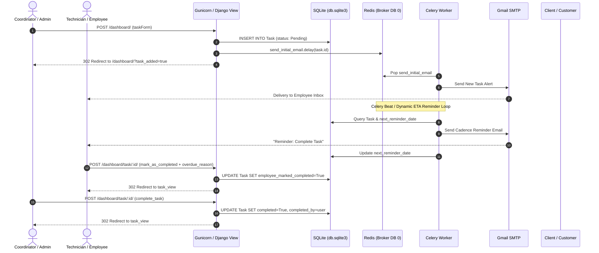
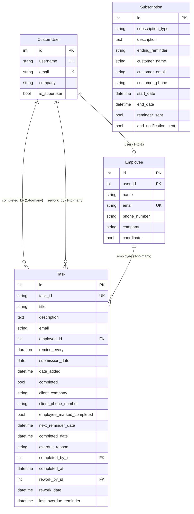

# Technical Audit & Codebase Analysis: MITR (Task & Subscription Management System)

---

## 1. Project Overview

- **Summary**: MITR is a multi-tenant B2B task assignment, tracking, and subscription monitoring web application featuring automated email notifications and progress analytics.
- **Problem it Solves**: Eliminates manual follow-ups and missed deadlines in service/hardware support companies (specifically Nescube Technology Pvt. Ltd. / Nestech India) by automatically dispatching cadence-based reminder emails for field tasks and customer subscription expirations.
- **Intended User**: Operations managers, coordinators, and field service technicians/employees in IT hardware and support services, as well as administrators tracking service contract lifecycles.

---

## 2. Tech Stack

| Layer | Technologies & Libraries |
| :--- | :--- |
| **Language** | Python 3 (Backend), HTML5/JavaScript (Frontend), Bash (Orchestration) |
| **Backend Framework** | Django 4.2.4, Gunicorn, Werkzeug, django-extensions |
| **Frontend** | Django Templates, Tailwind CSS 2.2.19 (CDN), FontAwesome 5.15.3, Vanilla JavaScript |
| **Asynchronous & Queuing** | Celery, Celery Beat, Redis (`django-redis` broker & cache) |
| **Database** | SQLite 3 (`database/db.sqlite3` configured in `config/settings.py`) |
| **Data & Reporting** | Pandas, Matplotlib (server-side graph rendering), XlsxWriter (Excel report generation) |
| **DevOps / Infra** | `start_mitr.sh` (local/VM process runner), WhiteNoise 6.x (static assets), self-signed OpenSSL certificates in `certificates/` |
| **AI / ML Integrations** | **None** (pure deterministic scheduling and reporting; no machine learning or LLM APIs utilized) |

---

## 3. Project Structure

```text
mitr/
├── config/                      # Project configuration & settings module
│   ├── __init__.py              # Celery app export
│   ├── asgi.py                  # ASGI server specification
│   ├── celery.py                # Celery application initialization & beat config
│   ├── settings.py              # Django core settings, DB, SMTP, cache & Celery beat config
│   ├── urls.py                  # Root URL dispatcher
│   └── wsgi.py                  # WSGI entry point for Gunicorn
├── MITR_app/                    # Primary business logic application
│   ├── admin.py                 # Django admin registration
│   ├── apps.py                  # App configuration & signal registration
│   ├── backends.py              # Custom email authentication backend
│   ├── forms.py                 # Forms for auth, tasks, employees, and date filters
│   ├── migrations/              # Database schema migrations
│   ├── models.py                # Database models (CustomUser, Employee, Task, Subscription)
│   ├── signals.py               # Post-save signals (e.g. plot generation on task update)
│   ├── tasks.py                 # Celery asynchronous worker tasks & email dispatches
│   ├── templates/               # Django HTML templates (Dashboard, Reports, Progress)
│   ├── urls.py                  # Application route definitions
│   ├── utils.py                 # Signal suppression utilities (context managers)
│   └── views.py                 # View controller functions and report generators
├── certificates/                # SSL certificate (cert.crt) and private key (cert.key)
├── database/                    # SQLite database store (db.sqlite3)
├── media/progress/              # Generated Matplotlib employee progress bar charts (.png)
├── static/                      # Static assets (images, logos, favicon)
├── data.json                    # Serialized production database dump
├── dump.rdb                     # Redis memory snapshot
├── celerybeat-schedule.db       # Celery Beat persistent schedule database
├── manage.py                    # Django CLI management utility
├── requirements.txt             # Python package dependencies
└── start_mitr.sh                # Startup script orchestrating Redis, Celery, and Gunicorn
```

### Module Responsibilities & Entry Points
- **Entry Points**:
  - Web Server: `config/wsgi.py` executed via Gunicorn on port `8080`.
  - Task Queue & Scheduler: `config/celery.py` executed via `celery worker` and `celery beat`.
  - CLI: `manage.py`.
- **Core Modules**:
  - `MITR_app/models.py`: Defines entities for multi-tenant accounts, employee profiles, service tasks, and subscriptions.
  - `MITR_app/views.py`: Monolithic view controller handling auth flows, task CRUD, coordinator assignment, reporting, and Excel export.
  - `MITR_app/tasks.py`: Handles background email execution for periodic task reminders, overdue task alerts, and subscription lifecycles.

---

## 4. Backend Architecture
- **Architectural Pattern**: **Django MVT (Model-View-Template)** with an asynchronous background worker layer (Celery + Redis). It uses a monolithic design without clear service or repository layer abstractions.

### 4.1 System Architecture Graph

```mermaid
graph TB
    subgraph ClientLayer["Client Layer (Browsers & Devices)"]
        UserAdmin["Admin / Superuser"]
        UserCoord["Coordinator / Manager"]
        UserTech["Technician / Employee"]
    end

    subgraph IngressLayer["Network & Ingress Layer"]
        HTTPS["HTTPS (Port 8080)<br/>TLS Certs (certificates/cert.crt, cert.key)"]
        Gunicorn["Gunicorn WSGI Server<br/>(config.wsgi:application)"]
    end

    subgraph DjangoCore["Django Application Core (MITR_app)"]
        subgraph MiddlewareStack["Django Middleware Stack"]
            SecMid["SecurityMiddleware / WhiteNoise"]
            SessMid["SessionMiddleware"]
            AuthMid["AuthenticationMiddleware<br/>(Custom EmailBackend)"]
            CSRFMid["CsrfViewMiddleware"]
        end

        subgraph ViewControllers["View Controllers (MITR_app/views.py)"]
            AuthViews["Auth Views<br/>(login_register, logout)"]
            DashViews["Dashboard & Task Views<br/>(dashboard, task_view, add_employee)"]
            CoordViews["Admin & Coordinator Views<br/>(employee_list, update_coordinator)"]
            ReportViews["Reporting Engine<br/>(summary_report, download_summary_report)"]
            SubViews["Subscription Views<br/>(subscriptions, add_subscription)"]
        end

        subgraph FormORM["Forms & Data Processing"]
            Forms["Forms & Validators<br/>(TaskForm, RegistrationForm, EmployeeForm)"]
            Signals["Signals (signals.py)<br/>(post_save on Task)"]
            ChartEngine["Chart Engine (Pandas + Matplotlib)<br/>(plot_employee_progress)"]
            ExcelEngine["Excel Streamer (XlsxWriter)<br/>(download_summary_report)"]
        end
    end

    subgraph StorageLayer["Data & Persistence Layer"]
        SQLite[("SQLite Database<br/>database/db.sqlite3")]
        RedisCache[("Redis DB 1 (127.0.0.1:6379/1)<br/>django-redis Cache")]
        MediaStorage[("Local File Storage<br/>media/progress/*.png")]
    end

    subgraph AsyncWorkerLayer["Background Jobs & Scheduler (Celery)"]
        RedisBroker[("Redis Broker & Result Backend<br/>redis://localhost:6379/0")]
        CeleryBeat["Celery Beat Scheduler<br/>(celerybeat-schedule.db)"]
        CeleryWorker["Celery Worker<br/>(--pool=solo, config.celery)"]
        
        subgraph CeleryTasks["Asynchronous Tasks (tasks.py)"]
            TInitial["send_initial_email"]
            TRemind["send_reminder_email"]
            TOverdue["check_overdue_tasks"]
            TSubRemind["check_subscription_reminders"]
            TSubEnded["check_ended_subscriptions"]
            TSubConf["send_subscription_confirmation_email"]
        end
    end

    subgraph ExternalServices["External Services & Clients"]
        SMTP["Gmail SMTP Server<br/>(smtp.gmail.com:587 TLS)"]
        ClientRecipients["Clients & Technicians (Email Notifications)"]
        InternalCC["Management (CC Email)"]
        AWSCheckIP["AWS CheckIP Service<br/>(checkip.amazonaws.com)"]
    end

    %% Client to Ingress
    UserAdmin -->|HTTPS| HTTPS
    UserCoord -->|HTTPS| HTTPS
    UserTech -->|HTTPS| HTTPS
    HTTPS --> Gunicorn
    Gunicorn --> MiddlewareStack
    MiddlewareStack --> ViewControllers

    %% Views interactions
    ViewControllers --> Forms
    Forms --> SQLite
    ViewControllers --> SQLite
    ViewControllers --> RedisCache
    ViewControllers --> ChartEngine
    ViewControllers --> ExcelEngine
    ViewControllers --> Signals
    Signals --> ChartEngine
    ChartEngine --> MediaStorage

    %% Async dispatch
    ViewControllers -.->|Enqueue Tasks .delay()| RedisBroker
    CeleryBeat -.->|Cron Schedules| RedisBroker
    RedisBroker --> CeleryWorker
    CeleryWorker --> CeleryTasks
    CeleryTasks --> SQLite
    CeleryTasks --> SMTP
    SMTP --> ClientRecipients
    SMTP --> InternalCC
    DjangoCore -.->|Startup IP check| AWSCheckIP
```

### 4.2 Task Lifecycle & Asynchronous Processing Flow



- **Request-Response Flow**:
  1. Client sends an HTTPS request to Gunicorn over port `8080`.
  2. Request passes through standard Django middleware (`SecurityMiddleware`, `SessionMiddleware`, `CsrfViewMiddleware`, `AuthenticationMiddleware`, `WhiteNoiseMiddleware`).
  3. `config/urls.py` delegates routes to `MITR_app/urls.py`.
  4. View functions in `MITR_app/views.py` directly interact with Django ORM models and form validations.
  5. Any long-running or deferred job (email delivery) invokes `task.delay()` or `apply_async()`, placing messages onto Redis DB 0.
  6. The view renders server-side HTML via Django templates or returns binary file streams (Excel/images) or JSON.
- **Layer Breakdown**:
  - *Service Layer*: **Missing**. Business logic (plot creation, Excel export, status recalculation) is tightly coupled inside `views.py` and `models.py`.
  - *Repository Layer*: **Implicit via Django ORM**. Model queries (`Task.objects.filter(...)`) are written directly inside view functions.
- **Middleware Used**:
  - `django.middleware.security.SecurityMiddleware`
  - `django.contrib.sessions.middleware.SessionMiddleware`
  - `django.middleware.common.CommonMiddleware`
  - `django.middleware.csrf.CsrfViewMiddleware`
  - `django.contrib.auth.middleware.AuthenticationMiddleware`
  - `django.contrib.messages.middleware.MessageMiddleware`
  - `django.middleware.clickjacking.XFrameOptionsMiddleware`
  - `whitenoise.middleware.WhiteNoiseMiddleware`

---

## 5. All API Endpoints

| HTTP Method | Route Path | Handler / Purpose | Request Body / Query Params | Response Structure |
| :--- | :--- | :--- | :--- | :--- |
| `GET` / `POST` | `/` | `login_register_view`: User login or tenant registration | **POST**: `login` or `register` action with `email`, `password`, `company` | HTML page or 302 redirect to `/dashboard/` |
| `GET` / `POST` | `/login_register/` | `login_register_view`: Alias for auth page | Same as `/` | HTML page or 302 redirect |
| `GET` / `POST` | `/logout/` | `logout_view`: Clears session and logs out user | None | 302 redirect to `/login_register/` |
| `GET` / `POST` | `/dashboard/` | `dashboard_view`: Main task dashboard and creation modal | **GET**: `?search=<str>&page=<int>`<br>**POST**: `taskForm` (title, description, client info, submission date, reminder interval) OR `addEmployeeForm` | HTML (`dashboard.html`) with paginated tasks |
| `GET` / `POST` | `/add_employee/` | `add_employee_view`: Dedicated form to register new employees | **POST**: `name`, `email`, `phone_number` | HTML (`add_employee.html`) or 302 redirect |
| `GET` / `POST` | `/dashboard/task/<int:task_id>/` | `task_view`: Detail view, task completion, and rework | **POST**: `mark_as_completed` (with `overdue_reason`), `complete_task`, or `rework_task` | HTML (`task_view.html`) |
| `GET` | `/task/<int:task_id>/delete/` | `delete_task_view`: Deletes specified task (superuser only) | Path param: `task_id` | 302 redirect to `/dashboard/` (or 401 HTTP response) |
| `GET` | `/task/<int:task_id>/set_incomplete/` | `set_incomplete_view`: Reopens completed task (superuser only) | Path param: `task_id` | 302 redirect to task view (or 401 response) |
| `GET` | `/employee_list/` | `employee_list_view`: Lists all employees for current user's company | None (session auth required) | HTML (`employee_list.html`) |
| `GET` / `POST` | `/confirm-remove-employee/<int:id>/` | `confirm_remove_employee`: Deletes employee record | Path param: `id` | HTML prompt on GET; 302 redirect on POST |
| `GET` | `/employee/<int:employee_id>/progress/` | `employee_progress`: Individual employee metrics & bar chart | Path param: `employee_id` | HTML (`employee_progress.html`) with embedded chart image |
| `GET` | `/summary_report/` | `summary_report`: Filterable task report table | **GET**: `?date=YYYY-MM-DD&report_type=daily\|weekly\|monthly&status_filter=all\|completed\|pending\|overdue\|completed_overdue` | HTML (`summary_report.html`) |
| `GET` | `/download_summary_report/<date>/<report_type>/<status_filter>/` | `download_summary_report`: Generates and downloads Excel report | Path params: `date`, `report_type`, `status_filter` | Binary spreadsheet stream (`application/vnd.openxmlformats-officedocument.spreadsheetml.sheet`) |
| `POST` | `/update-coordinator/<int:employee_id>/` | `update_coordinator`: Toggles coordinator privilege (`@csrf_exempt`) | Path param: `employee_id`<br>Body (JSON or Form): `{"coordinator": "true"\|"false"}` | JSON: `{"success": true, "coordinator": true}` |
| `GET` | `/subscriptions/` | `subscriptions`: Lists managed third-party customer subscriptions | **GET**: `?page=<int>` | HTML (`subscriptions.html`) |
| `POST` | `/add_subscription/` | `add_subscription`: Registers new customer subscription | Form data: `subscription_type`, `description`, `ending_reminder`, `customer_name`, `customer_email`, `customer_phone`, `end_date` | 302 redirect to `/subscriptions/` |
| `GET` | `/admin/*` | Standard Django admin interface | Django admin credentials | HTML Django Admin Suite |

---

## 6. Database Design



### Models & Schema Breakdown
1. **`CustomUser`** (extends `AbstractUser`):
   - `id`: AutoField (PK)
   - `username`: CharField(150), unique
   - `email`: EmailField, unique
   - `company`: CharField(100) — Defines tenant organization
   - `is_superuser`: BooleanField(default=False)
2. **`Employee`**:
   - `id`: AutoField (PK)
   - `user`: OneToOneField to `CustomUser` (nullable, cascade delete)
   - `name`: CharField(100)
   - `email`: EmailField, unique
   - `phone_number`: CharField(15)
   - `company`: CharField(100, default='TO_BE_ASSIGNED')
   - `coordinator`: BooleanField(default=False) — Grants managerial visibility
3. **`Task`**:
   - `id`: AutoField (PK)
   - `task_id`: CharField(50, unique=True, null=True, blank=True)
   - `title`: CharField(100)
   - `description`: TextField
   - `email`: EmailField (Client email)
   - `employee`: ForeignKey to `Employee` (null=True, blank=True, cascade delete)
   - `remind_every`: DurationField (e.g., 1 hour, 6 hours, 1 day)
   - `submission_date`: DateField
   - `date_added`: DateTimeField(default=timezone.now)
   - `completed`: BooleanField(default=False)
   - `client_company`: CharField(100, null=True)
   - `client_phone_number`: CharField(15)
   - `employee_marked_completed`: BooleanField(default=False)
   - `next_reminder_date`: DateTimeField(default=timezone.now)
   - `completed_date`: DateTimeField(null=True, blank=True)
   - `overdue_reason`: CharField(5000, null=True, default=False)
   - `completed_by`: ForeignKey to `CustomUser` (related_name='completed_tasks', SET_NULL)
   - `completed_at`: DateTimeField(null=True, blank=True)
   - `rework_by`: ForeignKey to `CustomUser` (related_name='reworked_tasks', SET_NULL)
   - `rework_date`: DateTimeField(null=True, blank=True)
   - `last_overdue_reminder`: DateTimeField(null=True, blank=True)
4. **`Subscription`**:
   - `id`: AutoField (PK)
   - `subscription_type`: CharField(50) (e.g., Netflix, Amazon Prime, Hotstar)
   - `description`: TextField
   - `ending_reminder`: CharField(20, choices=['1 Day', '1 Week', '1 Month'])
   - `customer_name`: CharField(100)
   - `customer_email`: EmailField
   - `customer_phone`: CharField(15)
   - `start_date`: DateTimeField(auto_now_add=True)
   - `end_date`: DateTimeField
   - `reminder_sent`: BooleanField(default=False)
   - `end_notification_sent`: BooleanField(default=False)

---

## 7. Authentication & Authorization
- **Authentication Mechanism**:
  - Django Session-based authentication stored via standard session cookies.
  - Custom Authentication Backend: `EmailBackend` in `MITR_app/backends.py` enables users to authenticate using their email address instead of a username.
- **Authorization & Role-Based Access Control (RBAC)**:
  - **Superuser (`is_superuser=True`)**: Global administrative access. Can view all tasks for the company, reassign tasks, mark tasks as incomplete, delete tasks, and manage subscriptions.
  - **Coordinator (`Employee.coordinator=True`)**: Managerial tier. Can view all employee tasks across their company, access employee lists, view employee productivity graphs, access summary reports, and create subscriptions.
  - **Regular Employee (`coordinator=False`)**: Restricted visibility. Can only view tasks explicitly assigned to their email (`employee__email=user_email.email`). Cannot view team lists or summary reports. Can submit task completion requests with mandatory overdue explanations.
  - **External / Unauthenticated**: Restricted to login/register views (except where endpoints accidentally lack `@login_required` decorators).

---

## 8. Key Business Logic
1. **Two-Phase Task Verification Workflow**:
   - *Phase 1 (Worker Submission)*: When an employee finishes an assignment, they flag `employee_marked_completed = True` in `task_view`. If the task is past its due date, the system strictly enforces an `overdue_reason`.
   - *Phase 2 (Managerial Audit)*: The employer or coordinator reviews the submission and can either approve it (`completed = True`, logging `completed_by` and `completed_at`) or reject it (`rework_task`, stamping `rework_by` and `rework_date`).
2. **Automated Celery Email Cadence**:
   - Initial dispatch: `send_initial_email` fires upon task registration via Celery.
   - Dynamic intervals: `send_reminder_email` runs periodically based on the task's `remind_every` duration (e.g. every 2 hours, 1 day) and automatically advances `next_reminder_date`.
   - Overdue throttling: For overdue tasks, reminders are scheduled every 12 hours with an 11-hour duplicate filter buffer.
3. **Automated Subscription Expiration Monitoring**:
   - Celery Beat executes `check_subscription_reminders` hourly, dynamically calculating expiration thresholds (1 day, 7 days, 30 days) and sending alerts to customers and internal management (`kk.dwivedi@nescubeonline.com`).
   - Midnight cron executes `check_ended_subscriptions` to trigger renewal notices.
4. **Data Analytics & Dynamic Chart Generation**:
   - `plot_employee_progress` compiles task distribution (Completed vs. Overdue vs. Pending) using Pandas and renders a PNG bar chart on disk via Matplotlib. Triggered both via a `post_save` Django signal in `signals.py` and on view access.
   - Dynamic Excel streaming in `download_summary_report` using `xlsxwriter` to format and deliver custom multi-column reports.

---

## 9. Missing / Incomplete Parts & Security Gaps

### Critical Security Vulnerabilities
- **Exposed Cleartext Credentials in Source Code**:
  - In `config/settings.py`, active Gmail SMTP credentials and App Password are committed in plaintext:
    ```python
    EMAIL_HOST_USER = 'mitr.taskreminder@gmail.com'
    EMAIL_HOST_PASSWORD = 'pldt fcgv vxva hmhj '
    ```
  - Committed SSL private key in `certificates/cert.key`.
  - Hardcoded production secret key in `config/settings.py` (`SECRET_KEY = 'django-insecure-+b2k#...'`).
- **Production Data & PII Committed to Repository**:
  - `data.json` contains a full database dump with real client phone numbers, personal email addresses, hardware ticket descriptions, and employee personal numbers.
- **Unauthenticated Sensitive Data Exfiltration (PII Leak)**:
  - The `download_summary_report` endpoint has **no authentication decorator** (`@login_required` is missing) and **no company filter** (`Task.objects.filter(...)` selects all tasks across all tenants). Anyone can download full client and task databases across all companies by hitting `/download_summary_report/2025-01-01/daily/all/`.
- **CSRF Bypass & Missing Authorization on Privileged Action**:
  - `update_coordinator` is decorated with `@csrf_exempt` and has no authentication check. Any anonymous user can send a POST request and promote any employee to Coordinator.
- **Multi-Tenant Leak in Subscriptions**:
  - The `Subscription` model has no `company` or tenant identifier. Subscriptions are globally visible across all companies.
- **State Modification via HTTP GET (CSRF/Web Crawler Vulnerability)**:
  - Both `delete_task_view` and `set_incomplete_view` execute deletions/mutations on standard `GET` requests without CSRF validation.
- **Production Misconfigurations**:
  - `DEBUG = True` and `ALLOWED_HOSTS = ['*']` in `config/settings.py`.
  - Blocking network call at module import: `requests.get('https://checkip.amazonaws.com')` executes during startup, which can block or crash the server if internet access is degraded.

### Critical Runtime Bugs & Architectural Flaws
- **Registration Crash (`NameError`)**:
  - In `MITR_app/views.py`, `backends = get_backends()` is executed during user registration, but `get_backends` is never imported, causing a fatal 500 error when registering new users.
- **Form Validation Crash (`TypeError`)**:
  - In `MITR_app/forms.py`, `clean_submission_date` raises a validation error on past dates, causing `cleaned_data.get('submission_date')` to return `None`. In `clean()`, the code attempts `None < date.today()`, crashing with a `TypeError` instead of displaying a user-friendly error.
- **Inverted Logic & Broken Overdue Celery Task**:
  - In `MITR_app/tasks.py`: `if task_id is not None:` logs that `task_id is None` (inverted condition).
  - In `check_overdue_tasks`: `Task.objects.filter(..., id=task_id)`. When scheduled periodically without arguments, `task_id` is `None`, querying `id=None` which returns zero tasks. The overdue checker never processes tasks.
- **Static Evaluation of Date Default in Model**:
  - In `MITR_app/models.py`, `submission_date = models.DateField(default=datetime.now())` evaluates `datetime.now()` at server launch time rather than passing the callable `timezone.now`. Every task defaults to the exact date the server process booted.
- **Database Concurrency Bottleneck (SQLite)**:
  - Running multi-process Gunicorn (`gunicorn -b 0.0.0.0:8080`) combined with concurrent Celery workers against SQLite causes `OperationalError: database is locked` under modest load.
- **Thread-Safety Issues with Matplotlib**:
  - Matplotlib is invoked inside web views and in `post_save` signals without headless, thread-safe backends (`matplotlib.use('Agg')`), risking worker lockups and memory leaks.
- **Dead / Orphaned Code**:
  - `add_task.html` is completely unreferenced by any view.
  - `generate_summary()` in `views.py` references a non-existent `created_at` field and is never called.
  - `remove_employee_view()` in `views.py` is orphaned and missing from `urls.py`.

---

## 10. One-Line Summary for Interview

> *"MITR is a Python/Django-based B2B task assignment and subscription tracking platform designed for hardware service providers, integrating Celery and Redis to automate client follow-ups and service renewal notifications. The system features multi-role dashboards and automated reporting, but represents an early-stage deployment requiring migration to PostgreSQL, API decoupling, and critical security remediations around credential management and tenant isolation."*
